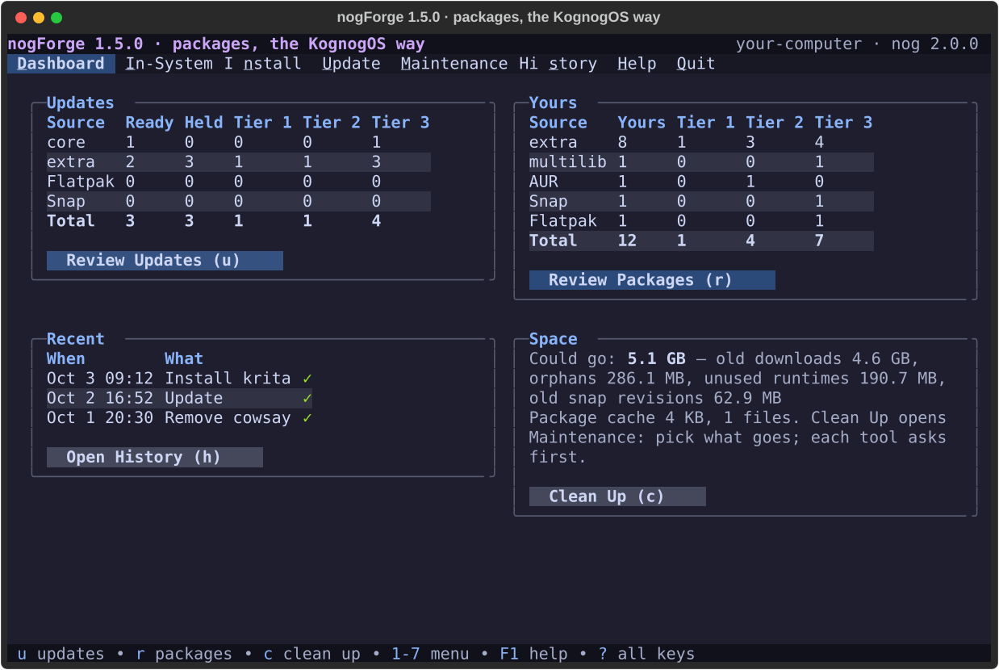
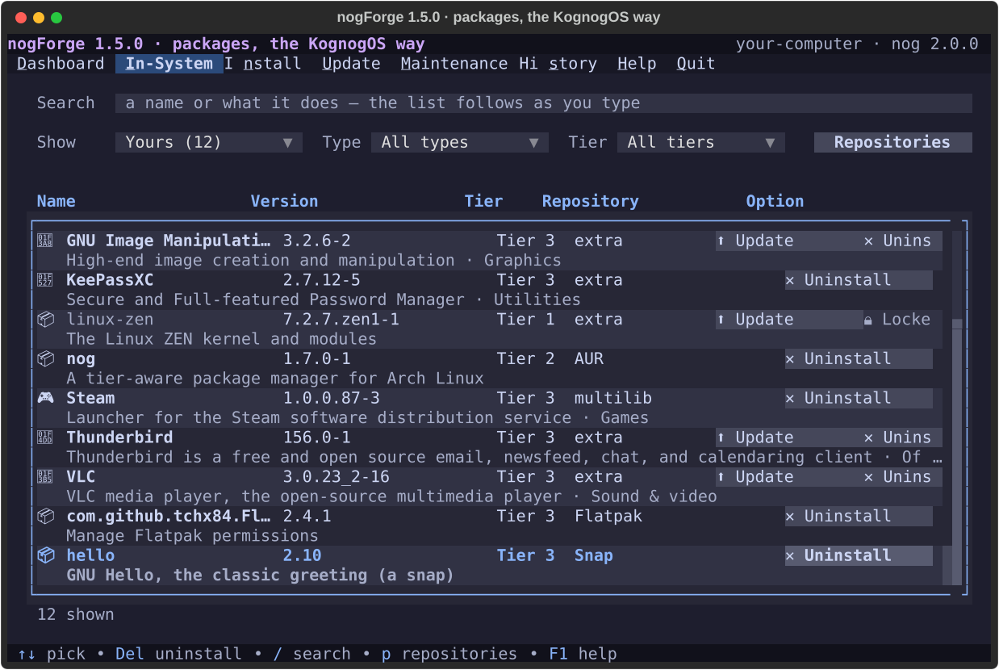
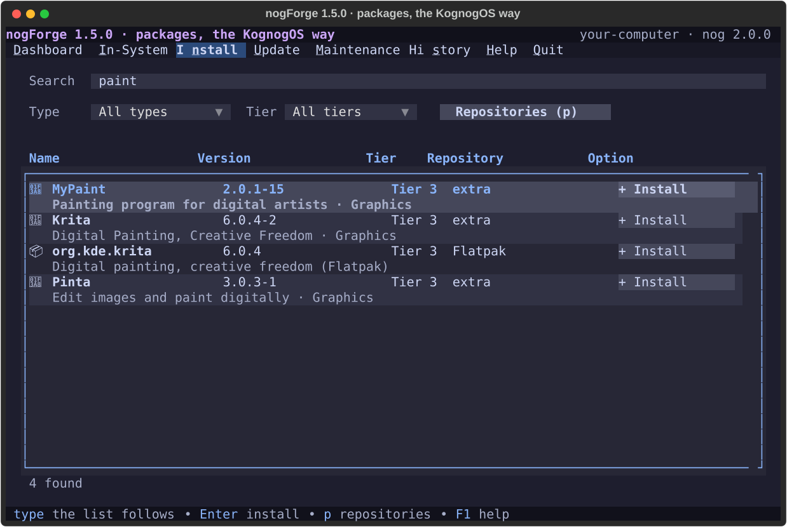
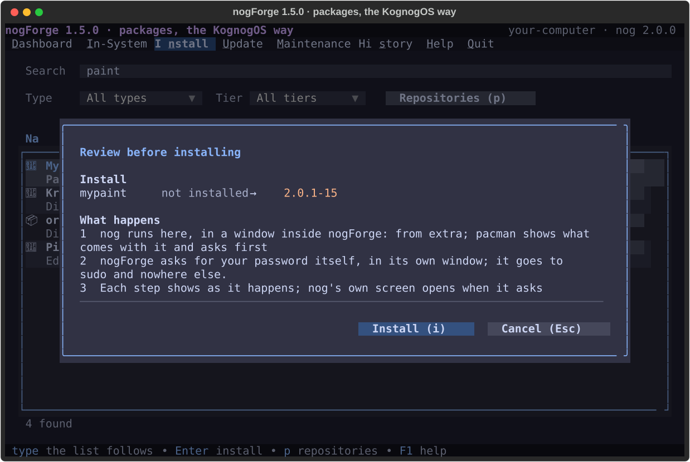
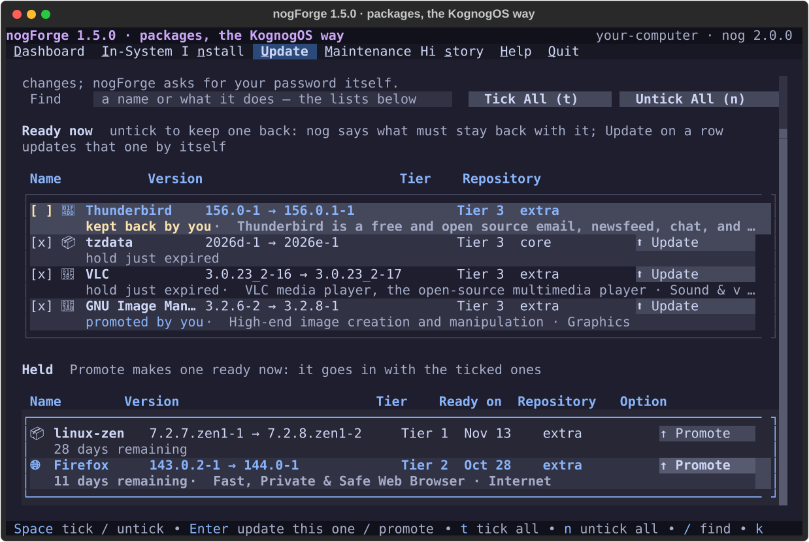
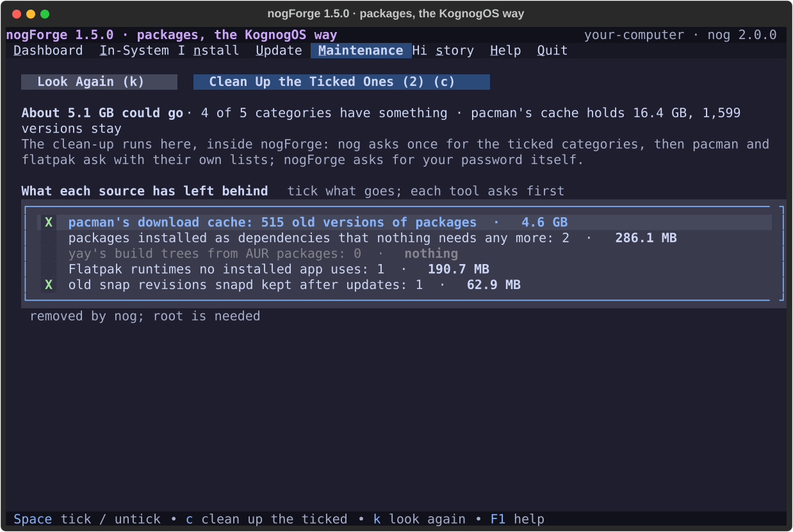
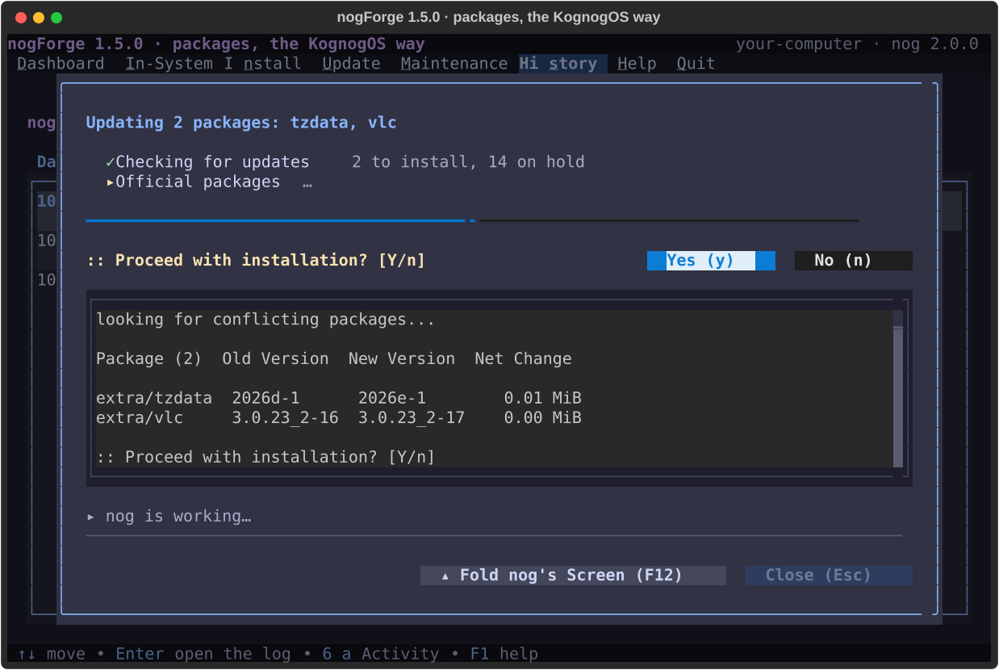
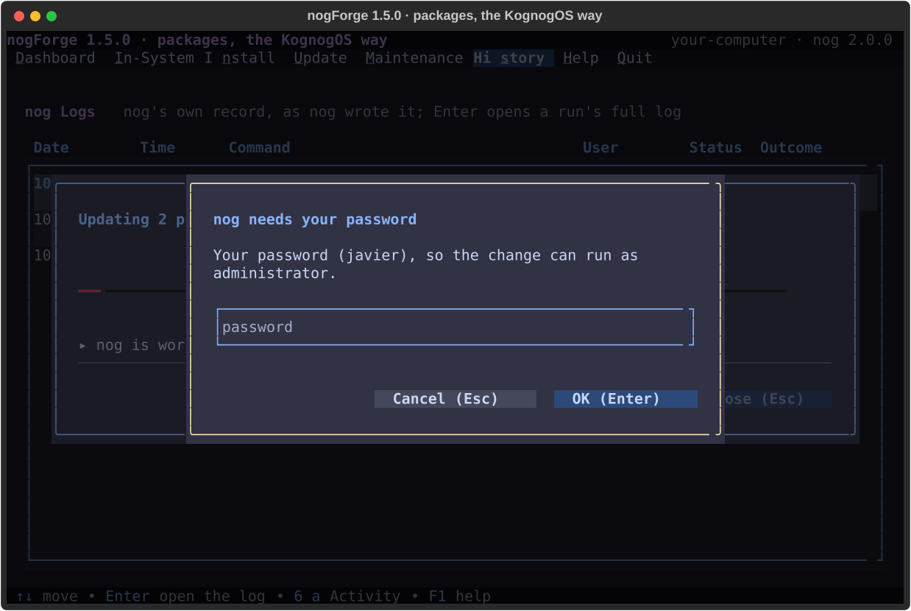
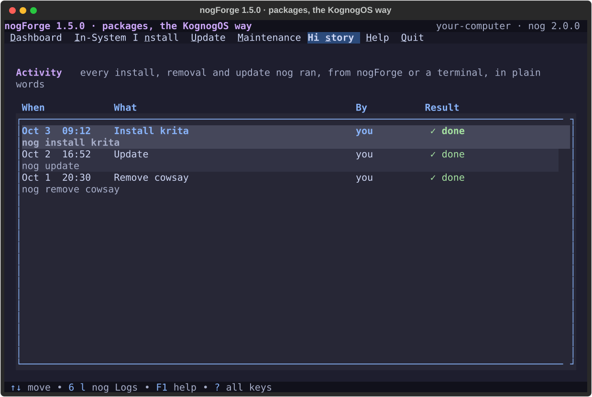
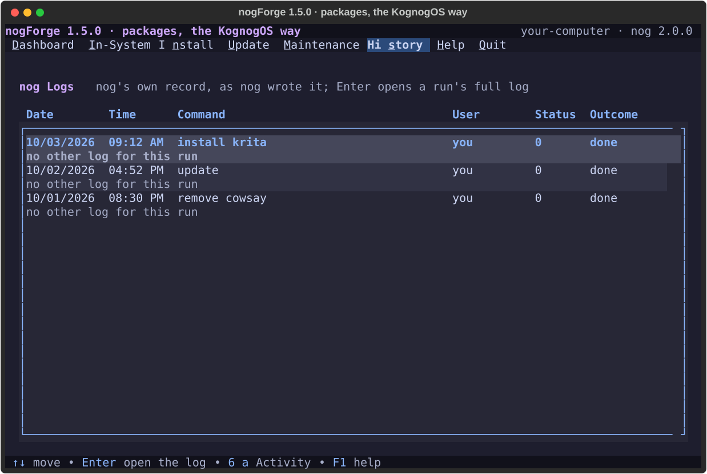

> ## 📦 nogForge has moved into the [Forge Suite](https://github.com/jetomev/forge-suite/tree/main/nogforge)
> Since **22 October 2026** nogForge lives in **[jetomev/forge-suite](https://github.com/jetomev/forge-suite)**, with its full history. New releases are tagged `nogforge-vX.Y.Z` there, and issues go there too. This repository is archived: its releases (up to 1.5.0) and issues stay readable, and the AUR package `nogforge` keeps working.

# nogForge

> Packages, the KognogOS way: what's installed, searching and installing, updates and the clean-up, for every source — the repositories, the AUR, Flatpak and Snap — in plain words, in a terminal. The decisions are **nog**'s; nogForge shows them.

> 🖥 **Where it runs:** **Arch Linux and KognogOS** (it runs on top of nog) · **no desktop needed**: any desktop, or none · **works on a plain text console** (a tty).


[](https://aur.archlinux.org/packages/nogforge)

---

## Why nogForge?

[nog](https://github.com/jetomev/nog) is KognogOS's package manager: pacman with a safety net. Every package has a **tier**, and a new version waits before it installs (30 days for the kernel and its kind, 15 for the desktop, 7 for the rest) so it can prove itself on other people's computers first.

nogForge brings what [Pamac](https://github.com/manjaro/pamac), Manjaro's software centre, does so well (with thanks: it's the inspiration) to the terminal, on top of nog: your programs as a table, a search with types, and updates you can read. **nog decides; nogForge shows it.** Tiers, holds and which packages must move together are never worked out twice.

---

## What's in 1.5

On **nog 2.0.0**, which answers for every source: **Flatpak apps and snaps are rows** like any package. In-System lists the ones installed (a base snap says **Locked**: it's the system under the snaps), with **✕ Uninstall**; Install finds them beside the repositories and the AUR, with **+ Install** — nog gets the exact name (`flatpak/<app-id>`, `snap/<name>`), and the review says who asks (flatpak shows what comes with it; snap never asks, so nog does). The Repositories window ticks Flatpak and Snap too. The Dashboard counts them from nog's list.

**Maintenance** is the new fifth page (**5**, **Ctrl+M**): nog's report of what each source has left behind — old downloads, orphans, the AUR helper's build trees, Flatpak runtimes no app uses, old snap revisions — each with its size. Tick what goes (Space), **Clean Up the Ticked Ones (c)**, and nog takes exactly those (`nog clean --only …`), asking once in its window before pacman and flatpak ask with their own lists. **c** anywhere else opens the page; the Dashboard's Space box says how much could go. History and Help moved to **6** and **7**.

Two small things from the backlog, the night of 16 October: the package now ships a **launcher entry** ([#16](https://github.com/jetomev/nogforge/issues/16)), so nogForge shows in every app menu and opens in your terminal; and nog's run window carries the **fold arrow** Javier asked for ([#23](https://github.com/jetomev/nogforge/issues/23)): a run is a progress bar with nog's screen folded behind a button that points down (▾) to open it and up (▴) to fold it again, F12 does the same, and nog's and pacman's yes/no questions come up as a bar with **Yes (y) / No (n)** with the table in view.

Fixed: after a change, Install's search ran again and its hidden list took the keyboard — a Del on In-System could open an install review. And three things the scripted bench found in the KognogOS VM the same night ([F-17](https://github.com/jetomev/nogforge/issues/29), [F-18](https://github.com/jetomev/nogforge/issues/30), [F-19](https://github.com/jetomev/nogforge/issues/31)): the Repositories window lists Flatpak and Snap when nog checked them, even before anything from them is installed; two runs in the same minute show newest first in nog Logs; and a run's caption says its own log is there to open. Tests: 67 (was 56), no warnings.

## What's in 1.4

From Javier's first run of nogForge inside **hypeForge Settings** (8 October 2026): **every name in the menu bar has a number and a Ctrl key**, the same in every Forge app. **1–6** go left to right: Dashboard, In-System, Install, Update, **History**, **Help**; History and Help now both open their menus (5 used to jump straight into one of History's pages). **Ctrl** + the underlined letter works too, even from inside a search box: Ctrl+U (Update) used to do nothing, and so did Ctrl+Y (History), now **Ctrl+S** under Javier's letter rule: each name gets the first letter of its name, or the next free letter of the name when that one is taken; Help is always H and Quit Q. A menu closes when you press its number again, and its name is lit while it's open. The **manual**, the **Keys** list, **License** and **About** show as pages instead of windows; Esc goes back. The bottom bar says **1-6 menu**. And nogForge **never closes while nog is working**: a half-finished update could break the system.

## What's in 1.3

Same evening, twenty minutes after 1.2.0 (Javier: *"much better… but"*): **every search follows as you type**, on In-System, Install and Update alike, and the Search button is gone (Install, which asks nog, waits half a second after your last keystroke and needs two characters). And the **filter rows are one row tall** instead of three: boxes, labels, drop-downs and buttons, so each page shows four or five more packages.

## What's in 1.1

- 🏠 **Dashboard**: updates per source and tier (nog's real plan), your packages per source and tier, the last things nog did, and the space old downloads take.
- 📦 **In-System**: what's on this computer, spreadsheet-style: badge, name, version, tier, repository, a **✕ Uninstall** button and, where nog has a newer version, **⬆ Update** beside it, with what it is underneath. System packages are **Locked**, with the reason: the system needs it to start, it's part of the base system, or another package needs it.
- 🔎 **Install**: search the repositories and the AUR (names and descriptions, best matches first) and **+ Install**.
- One **filter bar** on both: Search (the list follows as you type), Show (yours or all), Type (Games, Graphics, Office…), Tier, and **Repositories (p)**, a window to tick the repositories to show.
- ⬆ **Update**: nog's plan with your choices. Untick an update to keep it back, and **nog** says what must stay back with it, so a half-updated, broken system can't happen. A tick changes at once; while nog works out your choices, a yellow sign says so. **↑ Promote** makes a held one ready now; it goes in with the rest. **Update the Ticked Ones** hands nog exactly those, by name, and nog shows and installs only them; **⬆ Update** on a row does that one by itself, **Find** narrows the lists, **Tick All** / **Untick All** do the lot. Afterwards, **What changed** compares versions before and after, and after a new kernel offers **Restart Now (r)** or **Later (l)**.
- 🗂 **History**: **Activity** (everything nog ran, in plain words) and **nog Logs** (nog's own record; Enter opens a run whole, as it appeared on screen).
- 🪟 **nog works inside nogForge** *(1.1)*: a change opens a window over the app with nog's steps and a progress bar. nog's own screen opens by itself when nog or pacman asks something (pacman's table in view, **Yes (y) / No (n)** to answer), when something fails, or on **F12**. yay's menus for AUR builds are typed in it. Nothing leaves the app.
- 🔐 **The password is asked in nogForge's own box** *(1.1)*, on a desktop and on a text console alike. It goes to sudo and nowhere else; nothing is written to disk.
- 📖 A manual inside the app (**F1**), readable on a plain text console, nothing cut off at 100 columns.

Arch's app catalogue (the one Pamac uses) gives apps their proper names and a category badge (🎮 🎨 🎵 📝 🌐 ⚙); a terminal can't draw app icons, and on a text console the badges become two letters.

The design, drawn and approved before any code: [`docs/design/v0.1-screens.html`](docs/design/v0.1-screens.html).

---

## Screenshots

### Dashboard


### In-System


### Install, and the review before installing



### Update: one kept back, one promoted


### Maintenance: what each source has left behind (1.5)


### nog at work, inside nogForge (1.1; the fold arrow since 1.5)



### History: Activity and nog Logs



*Made from the running app (`python docs/screenshots/generate.py`) with a stand-in nog and a sample package list (since 1.5.0 with Flatpak and snap rows and a sample maintenance report).*

---

## Requirements

**Everything it needs** to build, run and test, with why, is in [docs/PACKAGING.md](docs/PACKAGING.md), measured from the code (the Forge Suite's [dependency audit](https://github.com/jetomev/forge-suite/issues/91), 2026-10-11).

- KognogOS or Arch Linux
- **nog 2.0.0 or newer** (nogForge reads its `--json` answers — the list, the search, the plan and the maintenance report, every source — and its steps, and hands it the ticked updates and the ticked clean-up categories by name)
- Python 3.11+, `python-textual`, `python-rich`, [`python-forgekit`](https://github.com/jetomev/forge-suite/tree/main/forgekit) 0.10.0+ (with `python-pyte`)
- `archlinux-appstream-data` for app names and badges (optional; without it every package gets the plain badge)
- `flatpak`, `snapd` (optional): their pages show when they're installed

## Installation

From the [AUR](https://aur.archlinux.org/packages/nogforge), with nog:

```bash
nog install nogforge
nogforge
```

Or from source:

```bash
git clone https://github.com/jetomev/nogforge.git
python3 nogforge/main.py
```

`man nogforge` has the reference; **F1** inside the app has the manual. The package also puts **nogForge in your app menu** (1.5.0): it opens in your terminal.

### Inside hypeForge Settings

hypeForge Settings shows nogForge as one of its pages. It starts nogForge with `--hypeforge` (or `--hypeForge`), an option meant for Settings, not for typing, so `--help` doesn't list it. Started that way, nogForge has **no Quit**: q and Ctrl+Q do nothing, and Settings closes it, asking nogForge first. Everything else is the same.

---

## Keys

| Key | Does |
|---|---|
| 1 – 7 | Dashboard, In-System, Install, Update, Maintenance, History (opens its menu), Help (opens its menu) |
| Ctrl + underlined letter | the same: Ctrl+D, Ctrl+I, Ctrl+N, Ctrl+U, Ctrl+M, Ctrl+S (History), Ctrl+H (Help); works from a search box too |
| u | open Update · on Update: update the ticked ones |
| t · n | on Update: tick all · untick all |
| / | on Update: the Find box (on In-System and Install: Search) |
| r | review packages (Install) |
| k | check for updates · on Maintenance: look again |
| c | open Maintenance · on Maintenance: clean up the ticked categories (nog and the tools ask first) |
| p | Repositories (In-System, Install) |
| Space | tick or untick an update · on Maintenance: a category |
| Enter | the row's option: install, remove, promote · on nog Logs: open the run |
| Del | uninstall the selected package (In-System) |
| / | search |
| F1 | help on this screen |
| ? | all keys |
| q · Ctrl+Q | quit (never while nog is working; not there inside hypeForge Settings) |

---

## Roadmap (each version tested by Javier before the next)

- [ ] **Settings** — nog's holds and sources, pacman's safe options, repositories (signatures required, key checked first), cleaning
- [x] **Flatpak and Snap**, with nog's install chain (nog C3, 1.9.0) and nog 2.0.0's every-source answers: rows, installs, uninstalls, the Repositories window — 1.5.0
- [x] **Maintenance**: nog 2.0.0's report of what each source has left behind, pick and clean — 1.5.0

---

## Changelog

### v1.5.0 — October 15, 2026 · every source, and Maintenance (on nog 2.0.0)

- **Flatpak apps and snaps are rows** (nog 2.0.0's `list --json` and `search --json`): In-System shows the installed ones with **✕ Uninstall** (a base snap says **Locked**, *the system under the snaps*); Install finds them beside the repositories and the AUR with **+ Install**. nog gets the exact name — its `install_as` (`flatpak/org.gnome.Calculator`, `snap/calculiva`) and `remove_as` (the app ID) — never a bare word that another source could answer. The review before a change says who asks: flatpak shows what comes with it; snap never asks, so nog does. The Repositories window (p) ticks Flatpak and Snap too; the Dashboard counts them from nog's rows (an older nog: the counters, as before).
- **Maintenance**, the fifth page (**5**, **Ctrl+M**, or **c** from anywhere): nog's report (`nog clean --json`) of what each source has left behind — old downloads, orphans, the AUR helper's build trees, Flatpak runtimes no app uses, old snap revisions — a row per category with its size, the highlighted one explained underneath (what it holds, who removes it). Tick what goes; **Clean Up the Ticked Ones (c)** hands nog exactly those (`nog clean --only a,b`) in the run window, where nog asks once and pacman and flatpak ask with their own lists. **Look Again (k)** refreshes. The Dashboard's Space box says how much could go, and its Clean Up opens the page. History is **6** now, Help **7**; the bottom bar says **1-7 menu**.
- **Fixed**: after a change, Install's search ran again and focused its list even when another page was shown; a Del on In-System could reach that hidden list and open an install review. The list takes the keyboard only while Install is the page shown.
- **A launcher entry** ([#16](https://github.com/jetomev/nogforge/issues/16)): the package installs `/usr/share/applications/nogforge.desktop` (`Terminal=true`, checked with `desktop-file-validate` in the build), so nogForge shows in every app menu and launcher. hypeForge's own copy, which opens it in a floating window, replaces it there by name, so it never shows twice.
- **The fold arrow** ([#23](https://github.com/jetomev/nogforge/issues/23)): the run window's button says which way the fold goes — **▾ nog's Screen (F12)** while a run is a progress bar with the screen folded, **▴ Fold nog's Screen (F12)** while it's open — on a text console `v` and `^`. The window itself is forgekit's, as since 1.1: the steps, the bar, the screen opening on a question or a failure, **Yes (y) / No (n)** for pacman's and nog's questions.
- **From the scripted bench in the KognogOS VM** (the night of 16 → 17 October, `scripts/bench-150.py`): [F-17](https://github.com/jetomev/nogforge/issues/29) the Repositories window listed Flatpak only once something from it was installed — now a source nog's plan checked is listed, rows or no rows; [F-18](https://github.com/jetomev/nogforge/issues/30) two runs in the same minute showed oldest first in nog Logs — the line nog wrote last is the newest; [F-19](https://github.com/jetomev/nogforge/issues/31) every run's caption said *no other log for this run* while Enter opened its own log — the caption now says what is there.
- History's Activity knows the new verbs (reinstall, lock, unlock, tier, info, status, history, keep). Needs nog 2.0.0. Tests: 67 (was 56), no warnings.

### v1.4.0 — October 8, 2026 · the menu's keys, the same in every Forge app ([#24](https://github.com/jetomev/nogforge/issues/24), [#25](https://github.com/jetomev/nogforge/issues/25), [#26](https://github.com/jetomev/nogforge/issues/26))

- **Ctrl + the underlined letter works everywhere** ([F-14, #24](https://github.com/jetomev/nogforge/issues/24)): Ctrl+U (Update) did nothing while the cursor was in a search box, because the box used Ctrl+U for "delete what I typed"; Ctrl+Y (History) had never been set up. Both now come from [forgekit 0.10.0](https://github.com/jetomev/forge-suite), which gives every menu entry its Ctrl key, ahead of the box. History's key became **Ctrl+S** under **Javier's letter rule**, the same in every Forge app: each name gets the first letter of its name, or the next free letter of the name when that one is taken; Help is always H and Quit Q (H is Help and I is In-System, so History gets S; Install gets N).
- **5 opens History's menu, 6 opens Help's** ([F-15, #25](https://github.com/jetomev/nogforge/issues/25)): 5 and 6 used to jump straight into History's two pages. Now the numbers go left to right along the menu bar, Help included, and the bottom bar says **1-6 menu** instead of "1-6 screens". **h** still opens Activity. From Javier's second run: **a menu's number pressed again closes it**, and **the open menu's name is lit**.
- **The manual, Keys, License and About are pages** in the main area, not windows (Javier: "yes, Keys and Manual as pages too"); Help is lit while they show, Esc goes back to the page you came from, and F1 still opens the manual at the page for where you are. On these pages nogForge's letter keys do nothing (so **c** there can't start a clean-up); numbers, Ctrl + letter, **?** and **F1** still work.
- **`--hypeforge`** ([#26](https://github.com/jetomev/nogforge/issues/26)): how hypeForge Settings starts nogForge as one of its pages: no Quit, and Settings closes it. Left out of `--help` on purpose.
- **Never closed while nog is working**: q, Ctrl+Q, Quit and Settings' request all wait until nog is done (before, Ctrl+Q during an update closed nogForge, and nog with it).
- Needs forgekit 0.10.0. Tests: 56 (was 42), no warnings (was none).

*Earlier versions: [docs/CHANGELOG.md](docs/CHANGELOG.md).*

## How this project is built

A human and AI collaboration: the screens were drawn and approved before any code, every change is tested (67 tests, a stand-in nog, so no test touches your packages), and the `testing/` folder holds the test matrices, published on purpose.

## Authors

**Javier ([@jetomev](https://github.com/jetomev))**: idea, direction, testing

**Claude (Anthropic)**: co-developer, architecture, implementation

## License

GPL v3. See [LICENSE](LICENSE).
